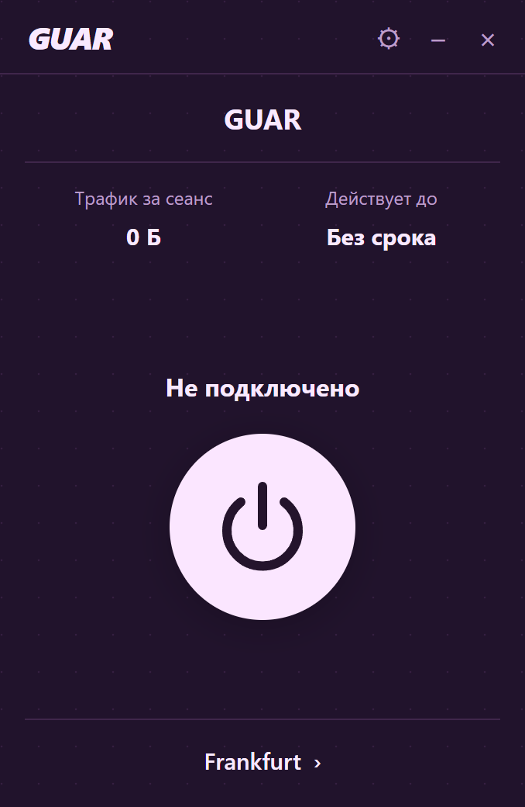
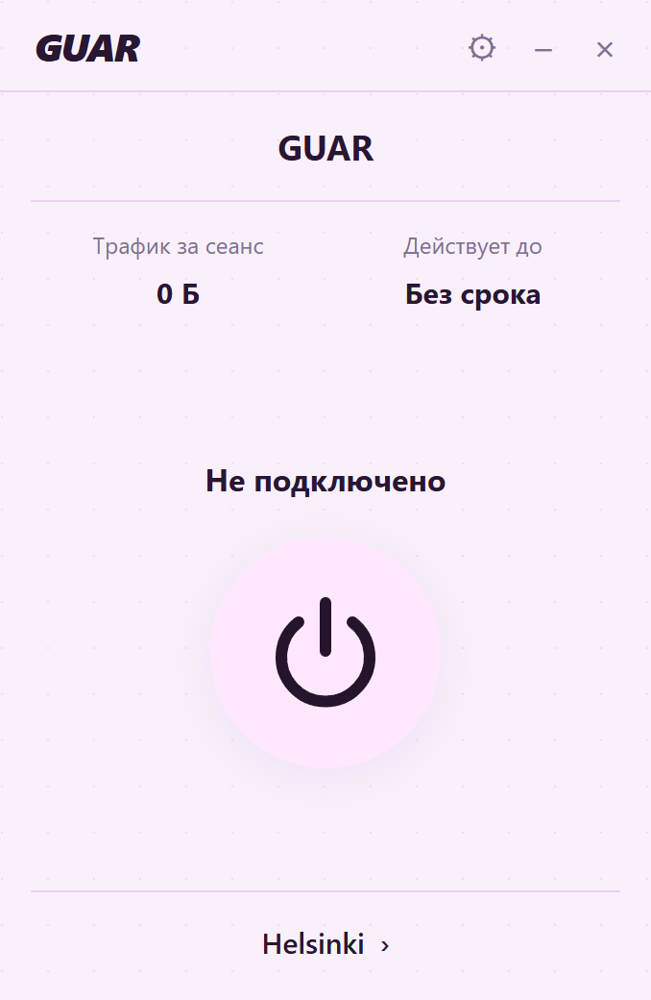

# GUAR Clash

Клиент для подключения к сервису [GUAR](https://guar.one).
Этот репозиторий предназначен для описания продукта, скриншотов, поддержки и
загрузки готовых установщиков. Независимая новая версия разрабатывается отдельно.

**Новая закрытая версия пока не опубликована.** До её выпуска должны быть
проверены права на компоненты, совместимость, TUN, установка и обновление на
поддерживаемых платформах, подписи и обязательные уведомления.

## Загрузка

[Страница Releases](https://github.com/GUAR-GH/GUAR-Clash/releases).
В этом пересозданном репозитории установщиков пока нет. Планируемые форматы
независимого клиента: Windows x64 NSIS и portable ZIP, macOS Intel/Apple Silicon
DMG, Linux x64/arm64 DEB и AppImage. Наличие цели сборки не подтверждает поддержку.

Кандидат работает с отдельно установленным совместимым Mihomo через локальный
документированный API. Ядро и служба не входят в установщик. Отдельный процесс
сам по себе не освобождает от требований GPL; выбранная композиция требует
проверки до закрытой поставки.

## Интерфейс в разработке

Скриншоты независимого кандидата с тестовыми данными. Это не реклама готового
релиза и не подтверждение полного совпадения с прежней версией.

| Тёмная тема | Светлая тема |
| --- | --- |
|  |  |

## Ранее выпущенные GPL-версии

Старые версии GUAR Clash основаны на Koala/Sparkle и сохраняют GPL и права
пользователей. [LICENSE](LICENSE) относится к исторической GPL-программе;
новая реализация не меняет лицензию старых версий.

Старый репозиторий был удалён владельцем; его архив и соответствующие исходники
ещё нужно восстановить. Работа над восстановлением отложена. Пока доступность
полных исходников старых бинарников не восстановлена и не проверена, новый
закрытый выпуск заблокирован. [Индекс прежних релизов](legal/legacy-source-index.json)
содержит сохранённые исторические метаданные, а не гарантию работающих загрузок.
Подробнее: [сохранение GPL-материалов](docs/legacy-preservation.md).

## Поддержка

[Сайт GUAR](https://guar.one) · [Бот](https://t.me/GUAR_ProtectionBot) ·
[Кабинет](https://my.guar.one).

[Ошибки](https://github.com/GUAR-GH/GUAR-Clash/issues) · [Помощь](SUPPORT.md) ·
[Безопасность](SECURITY.md) · [Условия выпуска](docs/releases.md).
Не публикуйте ссылки подписок, токены, ключи контроллера и приватные конфигурации.
